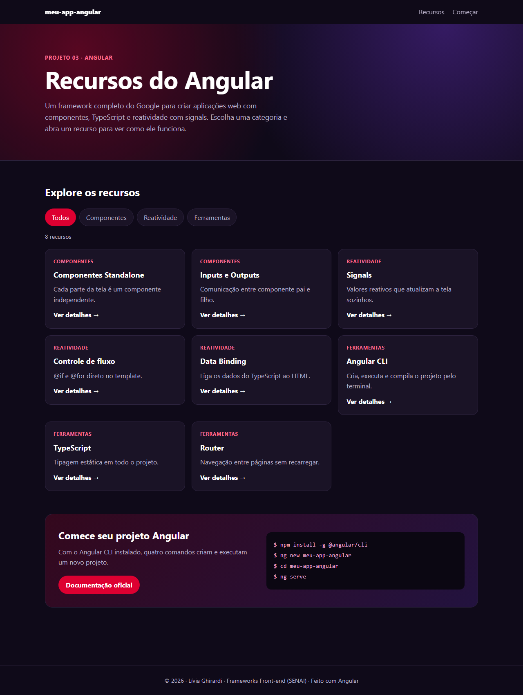
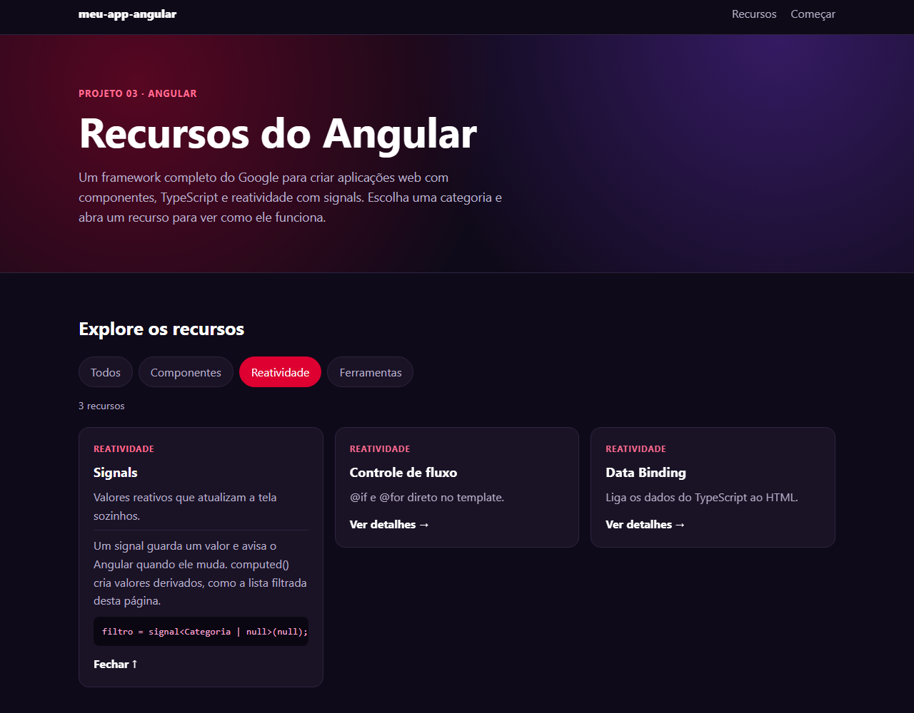

# Recursos do Angular — Projeto 03

Projeto Angular da atividade **Projetos com Frameworks Front-end (Aula 03)** da disciplina **Frameworks Front-end (SENAI)**.

A página apresenta os principais recursos do Angular. O usuário filtra os recursos por categoria e abre cada card para ver uma explicação e um exemplo de código.

- **Aplicação online:** https://angular-snowy-three.vercel.app/

## Prints





## Componentes

| Componente | Função |
|------------|--------|
| `App` | Componente raiz que monta a página |
| `Navbar` | Barra de navegação fixa no topo |
| `Hero` | Título e subtítulo, recebidos do `App` por `input()` |
| `Features` | Filtro por categoria e lista de recursos |
| `RecursoCard` | Card de cada recurso; avisa o `Features` por `output()` quando é aberto |
| `Cta` | Chamada para começar um projeto, com os comandos do Angular CLI |
| `Footer` | Rodapé |

Os dados ficam em `src/app/data/recursos.ts`.

## Conceitos utilizados

- **Componentes standalone**, cada um com seus arquivos `.ts`, `.html` e `.css`
- **`input()` e `output()`** para a comunicação entre componentes pai e filho
- **Signals** (`signal`, `computed`) para o filtro e o card aberto, sem `zone.js`
- **Controle de fluxo** com `@for`, `@if` e `@empty`
- **Data binding**: interpolação `{{ }}`, property binding `[ ]` e event binding `( )`
- **TypeScript** com interfaces (`Recurso`, `Categoria`)
- **Testes** com Vitest (`ng test`)

## Como executar

```bash
npm install
npm start
```

Acesse `http://localhost:4200`. Para gerar a versão de produção: `npm run build`.
